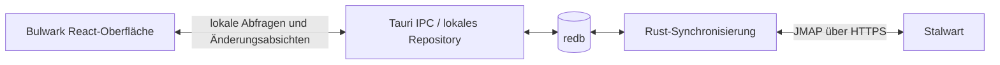

# Architektur: lokale Replik als Arbeitsgrundlage

Herakles Mail passt die Oberfläche und das Add-on-Modell von [Bulwark Webmail](https://github.com/bulwarkmail/webmail) für einen Offline-Desktopclient an. [Stalwart](https://www.stalwart.email/) ist das primäre JMAP-Serverziel und läuft unabhängig vom Client. Projektdanksagungen und Lizenzhinweise stehen im [README](../README.md#acknowledgements) und in der [NOTICE](../NOTICE).

## Verbindlicher Datenfluss

Die Oberfläche arbeitet immer mit redb, auch bei bestehender Internetverbindung.
Änderungen werden zuerst dauerhaft lokal gespeichert. Nur die Rust-Synchronisierung
kommuniziert mit Stalwart. Netzwerkfehler dürfen weder lokale Lesezugriffe verhindern
noch ausstehende Änderungen löschen. redb stellt Persistenz bereit; die
Synchronisierung ist eigener Anwendungscode.

## Upstream und Integrationsgrenze

Bulwark 1.20.0 liegt als unverändertes Git-Submodul unter `upstream/bulwark`, fixiert
auf `03e7cd86f102bc66a589b7b02d49523b00ae633a`. Quelle und Lizenz stehen zusätzlich
in `upstream/bulwark.lock.json`. LICENSE und NOTICE bleiben im Submodul erhalten.
Nach einem frischen Checkout: `git submodule update --init`.

Bulwarks bestehender Client (`lib/jmap/client.ts`) verwendet direkte Serverzugriffe
und registrierbare Hooks aus `lib/jmap/offline-hooks.ts`. Der Browser-Offline-Modus
in `lib/offline/` nutzt IndexedDB und ist ein Fallback. Das entspricht noch nicht
dem verbindlichen Desktop-Datenfluss.

Für die Übernahme werden ein lokaler JMAP-kompatibler Adapter und der gespeicherte
Sitzungszustand benötigt. `JMAPClient.fromOfflineSession` ist ein vorhandener
Einstiegspunkt für einen Client ohne Netzwerkzugriff. Der Desktop-Adapter muss
lokale Reads und Writes beantworten, Änderungen an die Stores melden und weitere
Netzwerkpfade (Sitzung, Blob-Download, Upload, Events) ebenfalls auf Rust umstellen.
Ein bloßer Austausch von IndexedDB durch redb reicht nicht. Die bestehende
IndexedDB-Synchronisierung darf nicht parallel mit dem Rust-Worker schreiben.
Die ursprünglichen Bulwark-Oberflächen werden jetzt über src/desktop/BulwarkApp.tsx eingebunden. Routing, Plugin-Binärspeicher und Offline-Hooks sind durch Desktop-Adapter ersetzt. Der lokale JMAP-Responder implementiert Mailbox/query/get, Email/query/get und Thread/get einschließlich Ergebnisreferenzen; andere Methoden bleiben unvollständig oder werden abgelehnt.

## Implementierter erster Datenpfad

- `src/mail-repository.ts`: lokale IPC-Abfragen, persistente Flag-Änderungen und separater Synchronisierungsaufruf.
- `src/desktop/`: originale Bulwark-Komponenten und Hostadapter. Lokale Sitzung zuerst laden, dann Hintergrundabgleich. Die ältere LocalMailbox-Entwicklungsansicht ist kein Anwendungseinstieg mehr.
- `src-tauri/src/replica.rs`: kontogetrennte Objekte, Serverzustände und geordnete Änderungswarteschlange in redb.
- `src-tauri/src/sync.rs`: HTTPS-Sitzungsermittlung, Mailbox-Vollabgleich, Email-Erstabgleich und paginierte `Email/changes`-Abgleiche.

Objekte und ihr Serverzustand werden transaktional geschrieben. Ein abgebrochener
Abgleich veröffentlicht keinen unvollständigen Checkpoint. `cannotCalculateChanges`
löst einen neuen Vollabgleich aus. Beim Erstabgleich wird geprüft, dass sich der
Email-Zustand während der Abfrage nicht geändert hat; sonst wird ohne Veröffentlichung
abgebrochen und beim nächsten Durchlauf erneut versucht.

Lokale Änderungen liegen als separate Absichten über dem Serverdatenbestand.
Dadurch überschreibt ein Download sie nicht. Die Warteschlange überlebt Neustarts
und Vollabgleiche. Erfolgreiche Änderungen werden einzeln bestätigt; später erzeugte
Änderungen bleiben erhalten. `ifInState` schützt Serverupdates; ein `stateMismatch`
bleibt für den nächsten Abgleich vorgemerkt. Für unterstützte Flags gilt: Die jüngste
lokale Absicht wird nach Aktualisierung der Serverbasis erneut versucht.

Permanente Fehler wie fehlende Nachrichten oder Schreibrechte bleiben sichtbar als
blockierte Einträge gespeichert und verhindern nicht den Abgleich anderer Änderungen.
Eine Oberfläche zum Verwerfen oder erneuten Freigeben dieser Einträge fehlt noch.
Nur idempotente Gelesen-/Markiert-Updates werden automatisch wiederholt; Versand
braucht eine separate Strategie gegen doppelte Zustellung.

## Noch offene Arbeit

- Die eingebundene Bulwark-Oberfläche funktional vervollständigen; alle JMAP-Lese-/Schreibmethoden, Ereignisse und Nebenpfade abdecken.
- Verschieben, Löschen, Entwürfe, Versand, Suchindex und weitere Mailfunktionen.
- Vollständige HTML-Textteile und Anhänge offline; aktuell Text-/HTML-Teile mit maximal 256 KiB pro Teil, keine Blob-Synchronisierung.
- Kalender, Kontakte, Dateien und die Funktionen der vollständigen Bulwark-Edition einschließlich OAuth, 2FA, Admin, Plugins und Einstellungssynchronisierung.
- Erstabgleich mit paginierter Staging-Ablage statt derzeitigem Aufbau im Arbeitsspeicher; lokale Seitenabfragen statt vollständiger Nachrichtenlisten.
- Der erste Zugang wird vor dem Speichern per JMAP-Sitzung geprüft und im nativen Systemschlüsselbund gesichert. Eine vorhandene `.env.local`/`.env.local.old` dient nur zur einmaligen Debug-Migration. Die Profilregistrierung liegt in redb; jedes Profil enthält mehrere Konten, deren Zugangsdaten getrennt im Systemschlüsselbund liegen. Profil- und Kontowechsel laden den ausgewählten JMAP-Zugang neu und trennen Profilcaches.
- Verschlüsselung lokaler Kontodaten, Speicherlimits und Cache-Verwaltung.
- Native Linux-/macOS-Validierung, Installationspakete, Signierung und Updates.

## Verifikation

24 Rust-Tests prüfen Persistenz nach Neustart, Kontotrennung, atomare Checkpoints,
Vollabgleich-Rennen, paginierte Deltas, Netzwerkabbrüche, abgelaufene Zustände,
Bestätigungen, lokale Folgeänderungen und permanente Ablehnungen. Der Frontend-Build
mit TypeScript 7.0.2 und der Windows-Tauri-Debug-Build sind erfolgreich. Linux und
macOS und ein vollständiger Live-Erstabgleich sind noch nicht getestet. Ein separat ausgeführter Nur-Lese-Live-Test hat Sitzung, Mailboxen, bis zu zehn Nachrichten und das erneute Lesen aus redb erfolgreich geprüft. Die automatisierten
Sync-Tests verwenden einen skriptgesteuerten Transport statt eines echten Servers.

## Nur-Lese-Betrieb

JMAP_READ_ONLY ist standardmäßig true. Die native IPC-Schicht sperrt neue Änderungen, der Synchronisierer überspringt die Warteschlange und der HTTP-Transport erlaubt nur Mailbox/get, Email/get, Email/query und Email/changes. Unbekannte Methoden sind gesperrt. Der Live-Test erzwingt diesen Modus unabhängig von der Konfiguration und verwendet eine temporäre Datenbank. Sitzungsumleitungen sind nur innerhalb derselben HTTPS-Herkunft erlaubt.

## Originale Oberfläche und Add-ons

Der Einstieg nutzt Bulwarks originale Mailansicht sowie Einstellungen, Kalender-, Kontakt- und Datei-Komponenten. Mail und Kalender sind lesend an die lokale Replik angebunden; Kontakte und Dateien sind noch offen. Plugin-Installation und Sandbox-Ausführung nutzen das originale Paketformat und die originalen Host-APIs. Pakete und UI-/Plugin-Daten liegen in redb. Details und ausdrücklich noch nicht unterstützte APIs: docs/addons.md.

Der Browser-Integrationstest prüft mit synthetischen Daten Mailanzeige, ZIP-Installation, Aktivierung, einen Plugin-Speicherzugriff und Wiederladen nach Neustart. Die native Testsuite enthält zusätzlich Tests für lokale Abfragen und JMAP-Ergebnisreferenzen. Keine vollständige Funktionsgleichheit oder plattformübergreifende Plugin-Kompatibilität ist damit nachgewiesen.

## Kalender-Replik

Der Desktop-Bootstrap initialisiert Bulwarks Kalenderfähigkeit ausdrücklich; dies fehlte bisher und versteckte den Navigationseintrag. src-tauri/src/calendar.rs speichert kontogetrennte Kalender-Snapshots inklusive Teilnehmeridentitäten, Terminen, Wiederholungsregeln und Overrides. Vollabgleich und CalendarEvent/changes veröffentlichen einen neuen Snapshot erst nach erfolgreichem Abschluss. Ein Abbruch erhält den alten Snapshot. Stalwarts getrennte Abrufe von utcStart/utcEnd und recurrenceOverrides werden berücksichtigt.

src/desktop/calendar.ts beantwortet lokale Kalender-JMAP-Aufrufe. Kalenderrechte werden im Nur-Lese-Modus eingeschränkt; Schreibmethoden werden abgelehnt. Datumsbereiche und Wiederholungen verwenden Bulwarks vorhandene Zeit- und Wiederholungshelfer. Die Kalenderansicht wird nach erfolgreichem Hintergrundabgleich aktualisiert. Gemeinsame Konten und alle Suchfilter sind noch nicht vollständig abgedeckt.

Der Live-Nur-Lese-Test hat einen Kalender und zwei Termine inklusive Folgeabgleich und erneutem redb-Öffnen geprüft. Der synthetische UI-Test prüft die Kalendernavigation, Terminanzeige und erneute Anzeige bei nicht erreichbarem Server. Der Schließpfad wird zusätzlich durch zwei Tests und einen echten Windows-Prozess-Schließtest geprüft.

## Freigaben und Sitzungsaktualisierung

`refresh_desktop_session` aktualisiert den lokal gespeicherten JMAP-Kontobestand.
Die App startet weiterhin sofort aus der gespeicherten Sitzung. Im Hintergrund
werden Änderungen an Session-State, Accounts und Fähigkeiten erkannt und der
ursprüngliche Bulwark-Client mit der neuen lokalen Sitzung ersetzt. Ohne Netzwerk
bleibt die zuletzt bekannte Sitzung verfügbar.

`src/desktop/accounts.ts` wählt alle persönlichen und freigegebenen Konten pro
Fähigkeit aus. Wie im Upstream gilt der serverweite Capability-Fallback nur für
explizit freigegebene Accounts mit leerer Capability-Liste, niemals gegen eine
explizite Einschränkung. Rust prüft dieselbe Regel beim Verbindungsaufbau.

`local_jmap` beantwortet auch gemischte Batches mit verschiedenen accountIds aus
separaten lokalen Repliken. Ergebnisreferenzen bleiben an ihre benannten früheren
Antworten gebunden. Vor dem Lesen werden aktuelle Sitzungszugehörigkeit und
Capability geprüft. Entfernte Konten werden nach erfolgreicher Sitzungsaktualisierung
nicht mehr über den nativen Adapter ausgeliefert. Offline kann eine noch unbekannte
serverseitige Rechteänderung naturgemäß erst beim nächsten erfolgreichen Kontakt
berücksichtigt werden. Alte Cache-Dateien werden nicht automatisch gelöscht.

Jeder Abgleich lädt zunächst alle erlaubten Mailbox-Bäume. Danach werden Kalender
und Nachrichten getrennt je Account synchronisiert. Ein Fehler in einer Freigabe
verhindert nicht den Versuch für andere Konten. Abgelehnte Kalender-Probes für reine
Mailfreigaben werden lokal markiert und an Bulwark als accountNotSupportedByMethod
beantwortet. Dadurch verschwinden berechtigte persönliche Kalender nicht wegen
einer Mailfreigabe ohne Kalenderrecht.

Verifikation: 24 native Tests und vier Browser-Tests; darunter Account-Isolation bei
gleichen Objekt-IDs, gemischte JMAP-Batches, entfernte Freigaben, Capability-Fallbacks,
freigegebene Ordner/Nachrichten und Kalender nach Offline-Neustart. Der Live-Test hat
sieben freigegebene Mailkonten mit Mailbox/get und einer begrenzten Email/query sowie Email/get für höchstens eine Nachricht je nicht leerem Konto geprüft.
Für diese sieben Freigaben meldet Stalwart keine Kalenderunterstützung. Der Test
hat keine Serverdaten verändert und eine temporäre Datenbank verwendet.

## Erster Schreibumfang

Der Benutzer hat den Schreibtest ausdrücklich freigegeben. Die native lokale
JMAP-Schicht akzeptiert Email/set ausschließlich für Änderungen an $seen/$flagged.
Jede Änderung an einer Nachricht wird atomar mit ihren Warteschlangeneinträgen in
redb gespeichert. Ein ungültiger gemischter Patch erzeugt keine halbe Änderung.
Nachfolgende Reads im selben JMAP-Batch sehen den lokal vorgemerkten Zustand.
Serverseitig schreibgeschützte Accounts und der konfigurierbare Nur-Lese-Modus
werden weiterhin geprüft. Ungelesen-/Thread-Zähler werden aus der lokalen Replik
berechnet, damit sie auch vor dem Serverabgleich stimmen.

Der native Synchronisierer verwendet idempotente Keyword-Patches mit ifInState,
bestätigt einzelne Queue-Einträge und liest danach den Serverzustand nach.
Schreibereignisse und Reconnects starten einen Abgleich. Ereignisse während eines
laufenden Abgleichs fordern einen weiteren Durchlauf an; es laufen keine zwei
Worker parallel. Die Statusleiste zeigt die Zahl ausstehender und blockierter
Änderungen. Andere Schreibmethoden bleiben auf der lokalen bzw. Transportgrenze
gesperrt, insbesondere Kalenderänderungen und Versand.

Der explizit gegatete Live-Test hat eine Stern-Markierung über dieselbe persistente
Warteschlange geändert, serverseitig gelesen und mit einem frischen Serverzustand
zurückgesetzt. Er verwendet eine temporäre Datenbank und schreibt vor der Mutation
einen lokalen Recovery-Datensatz ohne Zugangsdaten. Auch nach einem Timeout wird
die Wiederherstellung versucht. Der UI-Test prüft Stern-Änderung bei simuliertem
Serverausfall, den sichtbaren Pending-Status und die spätere Synchronisierung bei
Reconnect. Dies belegt keine Funktionsgleichheit für weitere Schreiboperationen.

## Upstream-Aktualisierungen

`upstream/bulwark` bleibt ein unverändertes Git-Submodul. Desktop-Anpassungen liegen in `src/desktop/`, `src-tauri/` und den kontrollierten Build-Transforms in `vite.config.ts`; dadurch gibt es keine zu pflegenden Upstream-Patches. Für ein Update den gewünschten Bulwark-Commit im Submodul auschecken, danach `upstream/bulwark.lock.json` mit Commit, Version und Lizenz aktualisieren und `npm run build`, `cargo check --manifest-path src-tauri/Cargo.toml` sowie die Browser-Integrationstests ausführen. Anschließend insbesondere Mail-Lesen, Composer, Plugins und geteilte Konten prüfen. Änderungen an Upstream-Dateien gehören nur dann ins Submodul, wenn sie zuerst upstream übernommen wurden.

## Composer-Transport (erster Schritt)

Der originale Composer bleibt unverändert. `src/desktop/bootstrap.ts` leitet Identitätsabfragen und den expliziten Sende-Batch an den Tauri-Befehl `composer_request` weiter. `src-tauri/src/sync.rs` beschränkt ihn auf diese Methoden, prüft Schreibrechte und Capability, nutzt HTTPS und führt keine automatische Wiederholung aus. Zugangsdaten bleiben in Rust. Der Versand ist online-only; eine unklare Transportantwort wird als Fehler angezeigt, damit Nutzer die Zustellung prüfen können, bevor sie erneut senden. Der Sendevorgang ist noch nicht redb-first und umfasst keine Uploads/Anhänge. Entwürfe werden als lokale Email-Objekte in redb gespeichert und nach Neustart angezeigt, aber noch nicht mit Stalwart synchronisiert. Dies ist keine vollständige Mail-Parität.

## Produktname und lokale Daten

Die sichtbare Produktkennung lautet Herakles Mail. Die bestehende Tauri-Anwendungskennung `org.jmapdesktop.client` bleibt vorerst stabil, weil Tauri sie für das App-Datenverzeichnis mit der redb-Mailreplik verwendet. Ein Wechsel benötigt einen getesteten Datenbank-Migrationspfad; ohne ihn würde die bisherige lokale Mailkopie scheinbar verschwinden.

## Diagnose-Protokoll

Native Ereignisse werden als eine JSON-Zeile pro Event in `logs/herakles.jsonl` im Tauri-App-Datenordner geschrieben; bei 2 MiB wird rotiert, drei ältere Dateien bleiben erhalten. Auf Windows liegt der Ordner unter `%APPDATA%\\org.jmapdesktop.client\\logs`. Rust protokolliert Sync-, Composer-, Entwurfs- und Speichervorgänge. Felder enthalten Eventname und Fehlerklasse, keine JMAP-Rohantworten, Zugangsdaten, Adressen oder Nachrichteninhalte. Die Statuszeile zeigt zusätzlich ausstehende und blockierte Entwurfslöschungen; genaue Syncfehler erscheinen dort.

## Push und Online-Modus

Der native Client hält Stalwarts JMAP-EventSource-Verbindung (SSE) offen. `StateChange`-Ereignisse lösen einen normalen Delta-Abgleich nach redb aus; bei Verbindungsabbruch verbindet Rust erneut. Ein 15-Sekunden-Abgleich bleibt als Ausfallsicherung aktiv. Der Schalter unten rechts setzt einen gespeicherten Offline-Modus, der Sync, Push und Versand pausiert; im Automatikmodus folgt die App dem System-Netzwerkstatus. „Online“ zeigt einen erfolgreichen Serverabgleich an, nicht nur eine aktive WLAN-Verbindung. Auf Android funktioniert die SSE-Verbindung im Vordergrund; Benachrichtigungen bei pausierter oder geschlossener App benötigen später eine Android-Push-Subscription.
